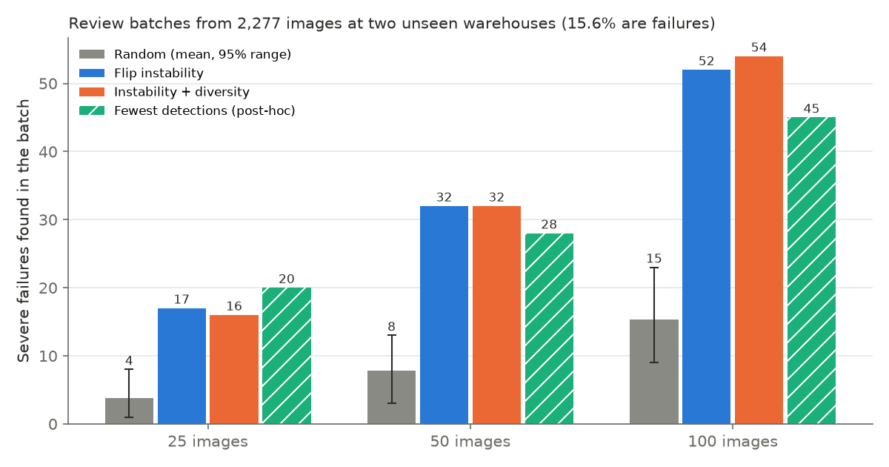

# Warehouse Perception Failure Explorer

Given a fixed human review budget, can a **label-blind ranking** pick warehouse images that contain more object-detection failures than random sampling does?

This project fine-tunes an object detector on some warehouses, runs it on two warehouses it has never seen, and tests whether ranking images by **flip instability** (does the detector's answer change when the image is mirrored?) surfaces more failures for human review than random picking.



## Result

- Out of 2,277 images from two unseen warehouses (15.6% severe failures), the 50 most unstable images contained **32 failures**, against **7.8** for random batches of 50 (95% range 3-13). That's about 4x, at both sites and at budgets of 25, 50 and 100.
- **Caveat found by a post-hoc check:** the ranking prefers sparse images, which fail more often under a recall-based rule. A simple "fewest detections" rule recovers most of the gain (28 of 50). Against random batches with the same mix of detection counts, instability still finds about 1.6x more failures.
- **Blind spot:** about 19% of failures are consistent misses, where the detector is wrong the same way in both views, so instability cannot see them.

Full write-up with methods, per-site results, sensitivity checks and limitations: **[docs/report.md](docs/report.md)**.

This is **review prioritization**, not active learning: the detector is frozen before any selection and is never retrained on reviewed images.

## Pipeline

```
LOCO release ──► ingest ──► validate ──► train ──► infer (original + flipped) ──► instability score
 (immutable)    manifests   quality      Faster     cached predictions,           per image
                (Parquet)   findings     R-CNN      label-blind
                                                                    │
            frozen on the tune site: score threshold, tau ◄─────────┤
                                                                    ▼
                                        selectors (random / instability / + diversity)
                                                                    │
                                        review labels read only here ▼
                                        experiment: failures found per batch ──► report, figures
```

**Leakage controls**
- The split is by environment: train on sites 2+5, tune on site 3, review pool = sites 1+4.
- The failure rule and the experiment design were committed before any review-pool label was read.
- Selectors take a label-free table as their only input.
- The experiment was run once.

All decisions, with the options considered and their costs, are in [docs/decision_log.md](docs/decision_log.md) (D1-D11).

## Data

[LOCO: Logistics Objects in Context](https://github.com/tum-fml/loco) (Mayershofer et al., ICMLA 2020; CC0-1.0). It has 5,097 annotated images and 151,428 boxes across five classes: pallet, small load carrier, stillage, pallet truck and forklift. The images were captured while walking through warehouses with handheld cameras. Details and verified counts are in [docs/dataset_card.md](docs/dataset_card.md). The data is not included in this repository.

## Running it

Requires Python 3.11-3.12 and [uv](https://docs.astral.sh/uv/). It was developed on an Apple M3 (MPS); CUDA and CPU also work.

1. Download `dataset.zip` (linked from the LOCO repository) and extract it to `data/raw/loco_v1/`, together with the annotation JSONs from the repo's `rgb/` folder.
2. Then run, in order:

```bash
uv sync
uv run wpfe ingest        # image + annotation manifests (Parquet)
uv run wpfe validate      # data-quality findings
uv run wpfe train         # ~3.5 h on an M3; resumable
uv run wpfe infer         # ~40 min; original + flipped views, resumable
uv run wpfe experiment    # seconds; reads cached predictions
uv run wpfe figures
uv run pytest             # 79 tests, synthetic fixtures, no data needed
```

Optional: `uv run wpfe benchmark --model owlv2_base --prompts descriptive` reproduces the zero-shot detector benchmark ([docs/detector_benchmark.md](docs/detector_benchmark.md)).

Configuration, including the frozen operating point and experiment design, is in [configs/default.yaml](configs/default.yaml).

## Repository layout

| Path | Contents |
|---|---|
| `src/wpfe/ingest.py`, `validate.py` | manifests and data-quality checks |
| `src/wpfe/detect.py`, `benchmark.py`, `coco_eval.py` | zero-shot detector benchmark |
| `src/wpfe/train.py`, `infer.py` | fine-tuning and cached two-view inference |
| `src/wpfe/boxes.py`, `matching.py` | box flipping, IoU, one-to-one matching |
| `src/wpfe/instability.py`, `select.py` | instability score and label-blind selectors |
| `src/wpfe/experiment.py`, `figures.py` | the experiment and report figures |
| `docs/` | report, decision log, dataset card, detector benchmark |

## Limitations

- Two review sites and eight camera sequences, so frame-level p-values overstate certainty.
- The recall-based failure event is coarse on sparse images (see the confound check in the report).
- One detector, one perturbation (horizontal flip).
- This is an offline analysis tool. It makes no claim about deployed systems or safety.
