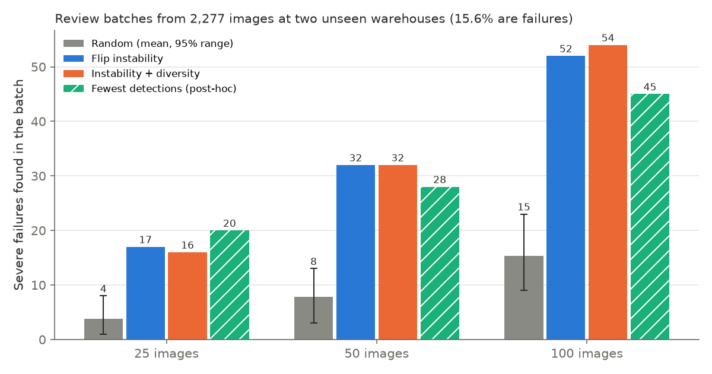
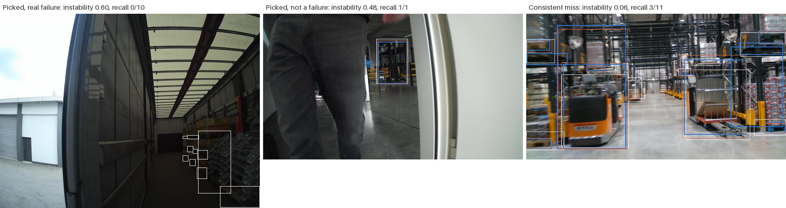

# Report: label-blind review prioritization for warehouse object detection

**Question.** Given a fixed human review budget, can a label-blind ranking pick warehouse images that contain more object-detection failures than random sampling does?

**Short answer.** Yes, but less than the headline suggests. Ranking by flip instability found about 4x more severe-failure images than random sampling, at both unseen warehouses and at every budget tested. A post-hoc check showed that much of this gain comes from preferring sparse images: a simple "fewest detections" rule recovers most of it. Against random batches with the same mix of detection counts, instability still finds about 1.6x more failures. About a fifth of failures are consistent misses that instability cannot see.

This is review prioritization: the detector is frozen before selection and is never retrained on reviewed images, so this is not an active-learning result.

## 1. Data and split

- **Dataset:** LOCO (Logistics Objects in Context, TUM, CC0-1.0). Images were captured while walking through warehouses with handheld cameras; they are not robot-mounted camera data. Five classes: pallet, small load carrier, stillage, pallet truck, forklift. See `docs/dataset_card.md`.
- **Environment-level split (D3, D6):** each LOCO subset is a different site.

| Role | Subsets | Annotated images | Used for |
|---|---|---|---|
| Train | 2, 5 | 1,947 | fine-tuning the detector |
| Tune | 3 | 873 | choosing the score threshold and tau |
| Review pool | 1, 4 | 2,277 | the selection experiment only |

The review pool's labels were first read by the evaluation code, after the failure rule and the experiment design were committed (commits `4f888ed` and earlier; evaluation code in `c7e18f1`).

## 2. Detector

Zero-shot open-vocabulary detectors (Grounding DINO tiny, OWLv2 base) were benchmarked first (`docs/detector_benchmark.md`). Both box whole pallet stacks as one object, while LOCO labels each pallet, so about 90% of images would have counted as failures, leaving no headroom for ranking (D5).

Instead, a COCO-pretrained torchvision Faster R-CNN (ResNet-50 FPN v2) was fine-tuned for 6 epochs on subsets 2 and 5 (shorter side 640 px, horizontal flip augmentation p = 0.5, fixed schedule, last epoch used) on an Apple M3 (MPS), about 3.5 hours in total. On the tune subset at the frozen operating point (score >= 0.4, IoU 0.5): precision 0.47, recall 0.42. Pallet trucks transferred poorly to the tune site (recall 0.15 on the per-epoch monitor sample) despite 1,366 training boxes, mostly from one site.

## 3. Failure event (frozen on the tune subset only)

- Matching: class-aware, greedy one-to-one by descending score, IoU >= 0.5 (same rule as pycocotools) (D8).
- An image is a **severe failure** if fewer than 40% of its ground-truth boxes are matched by predictions with score >= 0.4 (D1, D10).
- The score threshold maximizes F1 on the tune subset; tau gave a 43% failure rate there.

## 4. Selectors (label-blind)

All selectors read only the candidate table (image id, camera sequence, frame position, instability score); annotations are not an input.

- **Random:** 1,000 seeds per budget.
- **Flip instability (D9):** each image is scored twice, as-is and mirrored; mirrored boxes are mapped back and matched to the original boxes with the D8 rule. Instability = confidence mass of boxes without a partner in the other view / total confidence mass. Top-k by this score.
- **Instability + diversity (D11):** the same ranking, skipping any image within 2 frames of an earlier pick in the same camera sequence. A label-blind check showed 42 of the plain top 100 were within 2 frames of another pick.

## 5. Results (run once, as designed)

Review pool: 2,277 images, 355 severe failures (base rate 15.6%, lower than the tune site's 43%; the review sites were easier).

**Severe failures found per batch (whole pool):**

| Budget | Random mean (95% range) | Instability | Lift | Instability + diversity |
|---|---|---|---|---|
| 25 | 3.8 (1-8) | 17 | 4.4x | 16 |
| 50 | 7.8 (3-13) | 32 | 4.1x | 32 |
| 100 | 15.4 (9-23) | 52 | 3.4x | 54 |

No random batch out of 1,000 matched instability at any budget (p < 0.001).

**Per site, budget 50:** subset 1: 29 vs 8.8 random; subset 4: 30 vs 6.9 random. The effect holds at both unseen sites. The pool contains only 8 camera sequences and neighboring frames are correlated, so consistency across sites is the main robustness evidence; no sequence-level confidence interval is claimed.

**Sensitivity (IoU 0.3):** base rate drops to 8.4%; instability finds 30 vs 4.3 at budget 50. The conclusion does not depend on the IoU threshold.

**Diversity:** no consistent effect. It helped at subset 4 for small budgets (19 vs 16 at 25) and hurt at subset 1 (23 vs 29 at 50).

## 6. Confound check (post-hoc, not part of the frozen design)

The top-50 instability picks have a median of 2.5 ground-truth objects, against 21 for the pool. Sparse images fail more often under a recall rule (26% of images with at most 5 objects vs 15.6% overall), and a score-weighted instability is also more volatile when an image has few boxes. Both are label-free effects of image density, so two label-free comparisons were added:

| Budget | Instability | Fewest detections at the operating point | Random, same detection-count mix (mean) |
|---|---|---|---|
| 25 | 17 | **20** | 10.9 |
| 50 | **32** | 28 | 19.2 |
| 100 | **52** | 45 | 33.6 |

- Against density-matched random batches, instability still wins (p = 0.007 at 25, p < 0.001 at 50 and 100): the score carries signal beyond sparsity.
- A trivial "fewest detections" rule recovers most of the gain and beats instability at budget 25.

These comparisons were chosen after seeing the main result, so they are reported as exploratory.

## 7. Blind spot: consistent misses

67 of the 355 failures (19%) have below-median instability, and 10 failures have no detections at all at the operating point. When the detector misses an object the same way in both views, mirroring produces no disagreement.

*Left: a picked image that is a real failure (0 of 10 objects found). Middle: a picked image that is not a failure. Right: a consistent miss that instability ranks low. White: ground truth; blue: original-view predictions; orange: flipped-view predictions (score >= 0.4).*

## 8. Limitations

- **Base rate outside the target band.** The review pool's failure rate (15.6%) fell below the 20-50% band targeted on the tune site, because the review sites were easier.
- **Density confound.** The recall-based failure event is coarse on sparse images. Much of the measured gain is attributable to sparsity (section 6).
- **Few independent units.** Two review sites and 8 camera sequences; frame-level p-values overstate certainty.
- **One detector, one perturbation.** Results are for one fine-tuned Faster R-CNN trained with flip augmentation, and only horizontal flips were tested.
- **Greedy matching** is not globally optimal; it is kept for consistency with the standard evaluator.

## 9. What I would do next

- Combine signals: instability within detection-count strata, or a second detector's disagreement, which can expose consistent misses.
- Keep a small random slice of every review batch so blind spots are still sampled.
- Replace image recall with a density-robust failure event (for example, misses per image weighted by object size) and rerun on a new frozen split.

## Reproducing

See the README. Every number above is produced by `uv run wpfe experiment` from cached predictions; figures by `uv run wpfe figures`.
